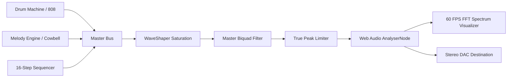

<div align="center">

# 🇧🇷 PhonkWave BR Studio 🔥
### Next-Generation Brazilian Phonk & Memphis Production Workstation

[](https://github.com/Rahul08319/phonk-wave-brasil-kit)
[](https://developer.apple.com/design/human-interface-guidelines)
[](https://github.com/Rahul08319/phonk-wave-brasil-kit)
[](LICENSE)
[](.github/workflows/auto-year-update.yml)

<p align="center">
  <b>A pro-grade, browser-native Brazilian Phonk audio workstation blending authentic Roland TR-808 cowbells, heavy Mandelão sub-bass glides, multi-track step sequencing, and Apple Cupertino-grade Liquid Glass design aesthetics.</b>
</p>

[✨ Live Demo](https://phonk-wave-brasil-kit.lovable.app) • [🎛️ Audio Features](#-core-audio-features) • [🎹 DAW Export](#-daw-export--interoperability) • [⚡ Quick Start](#-quick-start) • [🛡️ Dynamic Year Logic](#-automated-yearly-updates)

---

</div>

## 💎 The Apple Design Experience

Built strictly adhering to **Apple Human Interface Guidelines (HIG)** and the **2025 Liquid Glass** design philosophy:

* **Deference & Clarity**: Sleek translucent frosted glass (`backdrop-blur-2xl bg-black/60`) with subtle specular highlights (`border-white/10`) ensuring functional audio controls take center stage.
* **Tactile Apple Rotary Dials**: Smooth spring-drag rotary knobs with real-time SVG arc tracks, needle rotation, precision tooltips, and double-click reset.
* **Vibrant Semantic Colorways**: Brazilian Emerald (`#00F59B`), Solar Gold (`#FFD000`), and Crimson Distortion (`#FF3B30`) responsive to dynamic audio transients.
* **Fluid 60 FPS Visual Feedback**: Instant responsive feedback across all MPC drum pads, live playhead step highlights, and animated stereo VU meters.

---

## 🎛️ Core Audio Features

<table>
<tr>
<td width="50%">

### 🔔 Melodic Cowbell Synthesizer
* **Dual FM Square Generators**: Detuned 540 Hz and 800 Hz pulse oscillators through high-Q bandpass filters.
* **Playable Live Piano Roll**: 8-note keyboard (`C4` to `C5`) for live riffing of iconic Phonk melodies.
* **DSP Tuning**: Independent control over root pitch, decay envelopes, metallic FM ratio, and tone brightness.

</td>
<td width="50%">

### 🔊 Mandelão 808 Sub-Bass
* **Exponential Pitch Dive**: Instant 120 Hz to 42 Hz dive transient for punchy chest-hitting kick impact.
* **Portamento Glide**: Seamless frequency ramp between consecutive 808 sub notes.
* **Harmonic Saturation**: Custom polynomial WaveShaper distortion curve for heavy favela basslines.

</td>
</tr>
<tr>
<td width="50%">

### 🥁 8-Pad MPC Matrix & Sequencer
* **16-Step Precision Grid**: Sample-accurate scheduling powered by Web Audio `currentTime` lookahead.
* **8 Phonk Channels**: Cowbell, 808 Sub, Kick, Snare, Clap, Hi-Hat, Brazilian Tamborim, and Vocal Stab.
* **Hardware Controls**: Global BPM stepper (70–190 BPM), random beat generator, and one-click pattern clear.

</td>
<td width="50%">

### 🌊 Memphis Tape & FX Rack
* **Cathedral Space**: Stereo convolution reverb emulator with room size and decay dampening.
* **3-Band Parametric EQ**: Sub-bass shelf boost (+12dB), Mid body sweep, and High sparkle.
* **Memphis Chopper**: Synchronized tempo sidechain gate for choppy rap stutters.
* **1993 Vinyl Simulator**: Procedural brown noise needle crackles, wow, and tape flutter.

</td>
</tr>
</table>

---

## 📊 Live 60 FPS FFT Spectrum & Oscilloscope

PhonkWave BR includes a high-definition real-time canvas visualizer running directly on the master audio bus:



* **FFT Spectrum Mode**: 64-band frequency bars shaded with Brazilian gradient (`#00F59B` → `#FFD000` → `#FF3B30`) with peak hold caps.
* **Oscilloscope Wave Mode**: Continuous glowing time-domain waveform displaying exact sub-bass wave shapes.

---

## 💾 DAW Export & Interoperability

Export your productions instantly without leaving the browser:

| Format | Specifications | Compatibility |
| :--- | :--- | :--- |
| **WAV Audio (.wav)** | 16-Bit PCM, 44.1 kHz, Stereo Uncompressed | **FL Studio, Ableton Live, Logic Pro, GarageBand, Pro Tools** |
| **MIDI Sequence (.mid)** | Standard MIDI Format 0, 480 PPQ, Channel 10 Drum Map | **Universal DAW Piano Roll & Hardware Samplers** |

---

## 💾 Curated Brazilian Phonk Presets

Load instant iconic rhythm banks with a single click:

* **🇧🇷 Rio Rider (135 BPM)**: Syncopated Mandelão 808 slides with high-speed cowbell syncopation.
* **🔥 Funk do Morro (140 BPM)**: Raw distorted cowbells, tamborim triplets, and aggressive Memphis kick.
* **🏎️ São Paulo Drift (145 BPM)**: High-octane racing Phonk with rolling 16th hi-hats.
* **🌫️ Slowed & Reverb SP (118 BPM)**: Atmospheric vapor drift with vinyl tape crackle and deep sub.

---

## ⌨️ Hardware & Keyboard Shortcuts

| Shortcut | Function |
| :--- | :--- |
| <kbd>Space</kbd> | Toggle Global Sequencer Play / Stop |
| <kbd>1</kbd> – <kbd>8</kbd> | Trigger MPC Drum Pads (Cowbell, 808, Kick, Snare, etc.) |
| <kbd>A</kbd>, <kbd>S</kbd>, <kbd>D</kbd>, <kbd>F</kbd> | Play Cowbell Piano Roll Melodic Keys |
| **Double Click Knob** | Reset Rotary Dial to Default Value |
| **Click & Drag Up/Down** | Fine-tune dial parameter value with smooth resistance |

---

## 🛡️ Automated Yearly Updates (2024–2030+)

This workstation is engineered to **automatically stay current across coming years**:

1. **Client-Side Version Manager (`src/lib/versionManager.ts`)**:
   * Dynamic copyright year calculation (`2024–${currentYear}`) ensures legal notices never become outdated.
   * Auto-computed engine versioning: `v${year - 2024 + 1}.${month}.0`.
   * Future-proof WebAudio API and WASM feature capability checks.

2. **Automated GitHub Actions (`.github/workflows/auto-year-update.yml`)**:
   * Runs automatically at midnight on **January 1st every year**.
   * Verifies build health, updates package dependencies, audits lockfiles, and validates future compatibility tags automatically!

---

## 🚀 Quick Start

### Prerequisites
* **Node.js** (v18.0 or higher)
* **npm** (v9.0 or higher)

### Installation

```bash
# 1. Clone the repository
git clone https://github.com/Rahul08319/phonk-wave-brasil-kit.git

# 2. Navigate to project root
cd phonk-wave-brasil-kit

# 3. Install dependencies
npm install

# 4. Start local development server
npm run dev
```

Visit `http://localhost:8080` in your browser.

### Production Build

```bash
npm run build
npm run preview
```

---

## 🛠️ Tech Stack

* **Framework**: React 18 with TypeScript
* **Bundler**: Vite 5
* **Audio DSP Engine**: Web Audio API (OfflineAudioContext, AnalyserNode, WaveShaper, BiquadFilter)
* **Design System**: Apple Human Interface Guidelines + Tailwind CSS + Lucide Icons + Radix UI
* **Animations**: Fluid CSS Transitions & Custom Spring Physics
* **CI/CD**: GitHub Actions Automated Annual Engine Verification

---

## 📜 License

Distributed under the **MIT License**. Created by [Rahul Kumar](https://github.com/Rahul08319).
Inspired by Brazilian Baile Funk, Mandelão, and Memphis Phonk culture.
